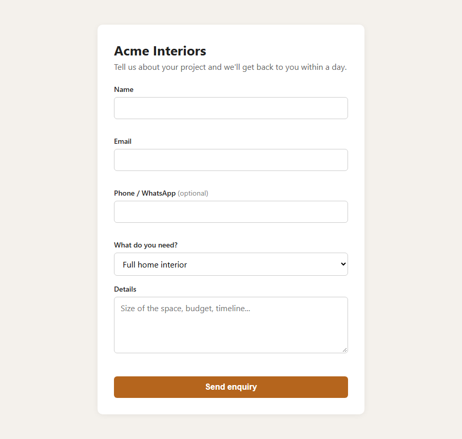

# lead-form-alerts


A small Flask service that saves every website enquiry to Google Sheets (or a CSV file) and sends an instant alert by email, Telegram or WhatsApp.

**The typical client request:** "People fill in the form on our website, but we only see it hours later in email, and some get lost. We want every enquiry in a sheet and a WhatsApp ping the moment it comes in."

**What you get:** the form keeps working as before, but every enquiry lands in a shared Google Sheet within a second, and the owner's phone buzzes with the lead's name, number and message. Hitting reply on the email alert goes straight to the customer.



## How it works

Every submission:

1. is validated, and obvious bot spam is dropped (a hidden "honeypot" field that only bots fill in)
2. is saved to a Google Sheet, or to `data/leads.csv` if Sheets isn't configured
3. sends an alert on each channel that's set up

The app serves its own contact form at `/` (the demo is for a fictional interior design firm). It can also take leads from other tools such as Tally, Typeform, Webflow, Elementor or Zapier through `/webhook`.

This is what an alert looks like, by email, Telegram or WhatsApp:

```
New enquiry from Priya Sharma

Email:   priya@example.com
Phone:   +91 00000 43210
Service: Modular kitchen
Source:  website form
Time:    2026-10-27 09:12:44 UTC

2BHK in Pune, budget around 4L. Can someone visit this weekend?
```

## Setup

```
pip install -r requirements.txt
cp .env.example .env      # Windows: copy .env.example .env
python app.py
```

Open http://localhost:5000 and submit the form. With nothing configured, leads go to `data/leads.csv` and the alert is only logged to the console. Each channel turns on once its variables are set in `.env`.

`GET /health` shows which storage backend and alert channels are active.

## Google Sheets

1. In Google Cloud, create a service account and download its JSON key as `credentials.json`.
2. Share your sheet with the service account's email address (editor access).
3. Put the sheet ID (the long string in the sheet's URL) in `GOOGLE_SHEET_ID`.

A header row is added automatically if the sheet is empty.

## Alerts

| Channel  | Variables | Notes |
|----------|-----------|-------|
| Email    | `SMTP_USER`, `SMTP_PASSWORD`, `NOTIFY_EMAIL` | For Gmail, create an App Password. Reply-To is set to the lead's email, so hitting reply answers the customer. |
| Telegram | `TELEGRAM_BOT_TOKEN`, `TELEGRAM_CHAT_ID` | Create a bot with @BotFather, message it once, then get your chat ID from `getUpdates`. |
| WhatsApp | `TWILIO_*`, `WHATSAPP_TO` | Uses the Twilio WhatsApp API. The sandbox number works for testing. |

If an alert fails (bad SMTP password, Telegram down), the lead is still saved and the error is logged.

## Webhook

`POST /webhook` accepts JSON or form data. Field names are matched loosely, so `Full Name`, `full_name` and `name` all end up in the same column. The same goes for `Mobile` / `phone` / `whatsapp` and so on (see `FIELD_ALIASES` in `app.py`). Tally's nested `data.fields` format is unpacked automatically.

```
curl -X POST "http://localhost:5000/webhook?source=landing-page" \
  -H "Content-Type: application/json" \
  -d '{"Full Name": "Rahul", "Email": "rahul@example.com", "Mobile": "0000043210"}'
```

Set `WEBHOOK_SECRET` and pass it as `?key=...` (or an `X-Webhook-Key` header) so random people can't post to it.

## Security notes

- Anything a visitor types is stored as plain text. Google Sheets rows are written in RAW mode, and CSV cells that would start a formula (`=HYPERLINK(...)` and similar) get a leading quote, so a malicious submission can't run as a formula when the owner opens the file.
- The webhook secret is compared in constant time.
- Keep `.env` and `credentials.json` out of git. Both are already in `.gitignore`.

## Tests

```
python -m pytest
```

The tests cover validation, the honeypot, webhook field mapping (including Tally's format), the webhook secret, formula neutralizing, and a failing alert channel not losing the lead.

## Deploying

It's a single Flask app with no database.

- **Render:** connect the repo, and `render.yaml` sets up the service. Fill in the secret env vars in the dashboard.
- **Docker:** `docker build -t lead-form-alerts . && docker run -p 8000:8000 --env-file .env lead-form-alerts`
- **Anything else:** `gunicorn app:app`

On hosts with an ephemeral filesystem (Render's free tier included), use Google Sheets rather than the CSV fallback, or the CSV is lost on every restart.

## License

MIT
